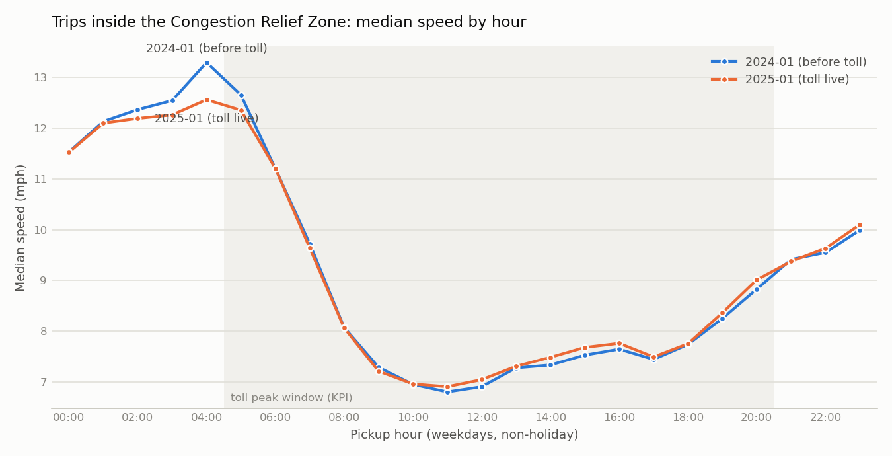
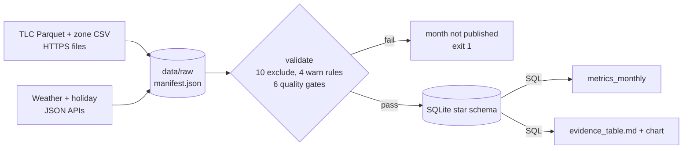

# Did congestion pricing make NYC taxi trips faster? A dependable TLC metric pipeline

**FDE Data Foundations Assignment - Track B (NYC TLC)** · Author: **Ansh Mahajan** (Roll 10345, ansh.24bcs10345@sst.scaler.com) · Repo: https://github.com/AnshMahajan-grep/nyc-crz-taxi-pipeline

A small, explainable pipeline that takes raw NYC TLC trip files and two public APIs through
**ingest → validate → model → metrics**, and produces an evidence table that answers one
leadership question with numbers that can be trusted and reproduced.

---

## 1. Problem

On **5 January 2025** New York started charging a congestion toll to enter Manhattan south of 60th St
(the **Congestion Relief Zone, CRZ**). The client is a **yellow-taxi fleet operator**. Its leadership asks:

> *"Are taxi trips inside the zone actually faster now, and has that changed what our drivers earn per hour
> or how much zone work there is? Should we plan shifts and positioning differently?"*

The data to answer this is spread across systems and messy:
- Trip records come from 4 different technology vendors.
- 4-15% of records are reversals, voids, or zero-distance taps.
- A growing block of records has missing fields.
- The trip data has **no CRZ flag** at all before 2025.

## 2. Users / stakeholders

| Stakeholder | What they need from this |
|---|---|
| Fleet operations lead (primary client) | Whether to reposition drivers toward CRZ work in toll hours |
| Finance / driver-relations | Whether driver revenue per engaged hour changed |
| Data owner at TLC (source owner) | Which validation rules we applied and why (feedback on data quality) |
| FDE / analytics team | A pipeline they can rerun every month without hand edits |

## 3. Project KPI

**Median in-trip speed (mph) of trips that start and end inside the CRZ, on non-holiday weekdays,
05:00-20:59 (the toll peak window).** It is compared with the same days of January a year earlier,
and against a **control group** (Manhattan trips wholly north of the CRZ).

Supporting metrics (8 in total, see [docs/data_model.md](docs/data_model.md#3-metrics-linked-to-the-kpi)):
- **Trust:** valid-trip rate.
- **Reliability:** p90 duration.
- **Driver economics:** fare per engaged hour.
- **Demand:** CRZ trips per weekday.
- **Sensitivity checks:** dry days only; excluding payment_type 0.

## 4. Results - final evidence table

Full table (auto-generated, do not hand-edit): **[outputs/evidence_table.md](outputs/evidence_table.md)**.
Baseline = 5-31 Jan 2024, treatment = 5-31 Jan 2025 (same day window, so 1-4 Jan 2025 pre-toll days are excluded).

| # | Metric | Jan 2024 | Jan 2025 | Change |
|---|---|---|---|---|
| 1 | Valid trip rate (trust) | 95.51% | 92.57% | -2.95 pp |
| 2 | **KPI: CRZ median speed, weekday peak** | **7.74 mph** | **7.85 mph** | **+1.4%** |
| 3 | Control (Manhattan outside CRZ) median speed | 8.65 mph | 8.45 mph | -2.3% |
| 4 | CRZ p90 trip duration | 20.8 min | 20.1 min | -3.6% |
| 5 | CRZ fare per engaged hour | $63.07 | $63.86 | +1.3% |
| 6 | CRZ-touching trips per weekday | 68,057 | 77,918 | +14.5% |
| 7 | KPI, dry days only | 7.83 mph | 7.83 mph | +0.1% |
| 8 | Control, dry days only | 8.75 mph | 8.46 mph | -3.3% |
| 9 | KPI excluding payment_type 0 | 7.72 mph | 7.80 mph | +1.0% |

Net KPI change vs control: **+3.7%** (all days) · **+3.4%** (dry days only).



### What the evidence says (and the decision it supports)

1. **The toll "protected" zone speeds rather than making trips dramatically faster.** Raw CRZ speed rose
   only 1.4% (7.74 → 7.85 mph). Over the same period the untolled control slowed 2.3%, so relative to the
   control, the zone is about **+3.7%** better off. The slow tail improved too: p90 duration fell 3.6%,
   about 0.7 min per trip.
2. **The relative effect survives the weather check, but the raw gain does not.** January 2024 had 12 wet
   days (156 mm, 8 snow days) against 5 in January 2025 (23 mm). On dry days only, CRZ speed is flat
   (+0.1%) while the control slowed 3.3%, so the net effect is still **+3.4%**. Reading the raw KPI alone
   ("+1.4%") would have credited part of the weather to the toll. Reading the dry-day KPI alone ("no
   change") would have missed that traffic outside the zone got worse. It also survives removing
   payment_type 0 records (+1.0% raw).
3. **The toll did not reduce taxi demand for zone trips.** CRZ-touching trips per weekday rose 14.5%, roughly
   in line with the overall rise in valid yellow-taxi records (+13.6%). Taxi passengers do not pay the
   vehicle toll, only a $0.75 surcharge.
4. **Driver earnings per engaged hour are essentially unchanged** (+1.3%, within the fare-schedule noise).

**Decision supported:**
- Do **not** plan shifts or promise customers on the assumption that CRZ trips are now materially faster.
  In absolute terms speeds are flat to +1.4%. The toll's effect shows up as *avoided slowdown*
  (about 3-4% vs. the rest of Manhattan), worth well under a minute per trip.
- **Do** keep, or grow, driver supply in the CRZ during toll hours. Demand held up and the revenue per
  engaged hour there did not fall.
- Re-run monthly (`python -m pipeline.run --months 2024-02 2025-02`, etc.) before changing that plan.

## 5. Sources (Class 4)

Full source map, ownership, grain, and gaps: **[docs/source_map.md](docs/source_map.md)**.

| Source | Owner | Retrieval mode | Grain |
|---|---|---|---|
| Yellow Taxi Trip Records (monthly Parquet) | NYC TLC (submitted by 4 tech vendors) | File over HTTPS | trip record |
| Taxi Zone Lookup (CSV) | NYC TLC | File over HTTPS | zone (265) |
| Open-Meteo Historical Weather | Open-Meteo / ERA5 | REST API, JSON | day |
| Nager.Date Public Holidays | Nager.Date | REST API, JSON | holiday |
| Modelled warehouse | this project | **SQL** (SQLite), all metrics are SQL queries | trip / zone / day |

## 6. Workflow and data model (Class 7)

Diagrams and table definitions: **[docs/data_model.md](docs/data_model.md)**.
- **Workflow:** hail (unrecorded) → pickup → in-trip → dropoff → payment → optional reversal.
- **Intervention:** CRZ toll. **Confounders:** weather and holidays. **Outcomes:** speed, duration tail, fare per hour, volume.
- **Star schema:** `fact_trip` (one row per source record, *including invalid ones*, with flag bitmasks),
  `dim_zone` (with `is_crz`), `dim_date` (holiday + weather + toll-live), and `metrics_monthly`.



## 7. Setup and run

Requires Python 3.10+ and internet access. The first run downloads about 110 MB.

```bash
git clone https://github.com/AnshMahajan-grep/nyc-crz-taxi-pipeline.git && cd nyc-crz-taxi-pipeline
python -m venv .venv && .venv\Scripts\activate      # macOS/Linux: source .venv/bin/activate
pip install -r requirements.txt

python -m pytest -q                 # 17 fast tests, no network needed
python -m pipeline.run              # default: 2024-01 vs 2025-01, ~10-15 min on a laptop
python -m pipeline.run --months 2024-02 2025-02    # any months TLC has published (oldest first)
python -m pipeline.run --force-download            # ignore cached raw files
```

Optional: `set TLC_WAREHOUSE=C:\temp\tlc.sqlite` (or `export ...`) keeps the ~1 GB SQLite file out of
OneDrive/Dropbox. Sync clients lock large files mid-write and make the run much slower.

**Outputs**

| Path | What |
|---|---|
| `outputs/evidence_table.md` / `.csv` | Final evidence table (baseline vs treatment) |
| `outputs/crz_speed_by_hour.png` / `.csv` | Hourly KPI profile |
| `outputs/validation/validation_<month>.md` / `.json` | Gate results + per-rule counts + CRZ cross-check |
| `outputs/validation/quarantine_sample_<month>.csv` | Example rows for every exclude rule |
| `outputs/profile/profile_<month>.md` | Raw column profile (nulls, ranges, distinct values) |
| `outputs/run_history.csv` | One row per stage per run: status, seconds, rows |
| `outputs/run_summary.json` | Last run: months ok/failed, headline metrics |
| `warehouse/tlc.sqlite` | Queryable star schema (git-ignored, rebuilt by the pipeline) |
| `logs/pipeline_<run_id>.log` | Full log (git-ignored). Example logs are in `docs/evidence_*.log` |

## 8. Retrieval - how we know it's complete (Class 5)

Every raw input is saved **unaltered** in `data/raw/`. It is recorded in [`data/raw/manifest.json`](data/raw/manifest.json)
with URL, retrieval time, bytes, SHA-256, and row count. Completeness checks:

| Check | Where |
|---|---|
| Downloaded bytes = HTTP `Content-Length`; writes go to `.part` and are renamed only on success | `ingest.fetch_trip_file` |
| Parquet footer readable (a truncated file has none) | `ingest.fetch_trip_file` |
| Rows loaded = footer row count (2,964,624 and 3,475,226) | gate `row_count_matches_source_footer` |
| Every calendar day present, and each day has ≥ 10,000 trips | gates `every_day_present`, `min_trips_per_day` |
| Weather API returns exactly one record per day; holiday list non-empty | `ingest.fetch_weather/holidays` |
| Warehouse row count after insert = validated row count | `model.load_month` |

On rerun, a raw file is reused only if its SHA-256 still matches the manifest. If someone edits or
corrupts it, it is re-downloaded.

## 9. Validation - rules, not silent fixes (Class 6)

Profiling ([outputs/profile/](outputs/profile/)) came first; the rules were written from what it showed.
Every rule **sets a bit flag**; no row is deleted or edited. Rows breaking an *exclude* rule stay in `fact_trip`
with `is_valid = 0`. *Warn* rules keep the row and are tested with a sensitivity metric.

| Exclude rule | Business reason | Jan 2024 | Jan 2025 |
|---|---|---|---|
| NEGATIVE_FARE | Accounting reversals/voids, not trips (83% in 2024 have an exact mirror positive twin) | 1.26% | 4.15% |
| ZERO_DISTANCE | No movement recorded | 2.04% | 2.62% |
| TOO_SHORT (< 60 s) | Meter tapped on and off | 1.16% | 1.10% |
| UNKNOWN_LOCATION (264/265) | Can't be placed in or out of the CRZ | 1.06% | 0.82% |
| TOO_LONG (> 3 h), NON_POSITIVE_DURATION, IMPLAUSIBLE_SPEED (> 80 mph), IMPLAUSIBLE_DISTANCE (> 100 mi), OUT_OF_PERIOD (e.g. a 2002 timestamp), DUPLICATE | Clock, meter, or odometer errors | < 0.1% each | < 0.1% each |

| Warn rule | Why kept | How tested |
|---|---|---|
| PAYMENT_TYPE_0: null passenger/ratecode fields, **4.7% → 15.5% of records** | Timestamps and distances look normal (median 2.0 mi, 14 min) | KPI excl. payment_type 0 (+1.0% vs +1.4%, same conclusion) |
| HAS_REVERSAL: positive twin of a reversal | Real trip, but revenue was voided | Excluded from fare-per-hour only |
| UNKNOWN_RATECODE (99), ZERO_PASSENGERS | Doesn't affect speed or fare | Reported |

**Quality gates.** If any gate fails, the month is not loaded or published:
- row count matches the source footer
- ≤ 1% out-of-period
- all days present
- ≥ 10k trips/day
- ≥ 85% valid
- **CRZ zone list agrees with the toll flag ≥ 90%** (observed 93.2%)

Full per-month reports: [outputs/validation/](outputs/validation/).

## 10. Pipeline dependability (Class 8)

| Concern | Behaviour |
|---|---|
| Logging | Every stage logs start, end, duration, and row counts to console + `logs/`. It also appends to `outputs/run_history.csv` |
| Rerun / idempotency | Raw files are cached by checksum. Each month is a warehouse **partition**: delete + insert in **one transaction**. Dimensions are upserted. Rerunning never duplicates rows, and a crash mid-load leaves the previous version intact. The `test_model_load_is_idempotent...` test proves this |
| Transient failures | HTTP GET retried 4× with exponential backoff |
| Permanent failures | Unpublished month (403/404), truncated file, schema drift (missing required column), or failed quality gate: that month stops with a clear message, and the other months continue |
| No partial publishing | The evidence table is regenerated only if **every** requested month succeeded. Exit code `1` on any failure, so a scheduler/CI can alert |
| Evidence of both paths | [docs/evidence_rerun.log](docs/evidence_rerun.log) (rerun reusing raw inputs) and [docs/evidence_failed_run.log](docs/evidence_failed_run.log) (unpublished month → exit 1, evidence untouched) |
| Tests | `tests/test_pipeline.py`: every exclude rule, warn rules, reversal twins, segments, gate failures, idempotent load, metric arithmetic |

## 11. Known / Unknown / Assumption / Limitation

| Type | Statement |
|---|---|
| **Known** | Both trip files are complete: bytes, footer row counts, all 31 days present, gates passed |
| **Known** | Our 38-zone CRZ list matches the 2025 toll flag: every listed zone is tolled on ≥ 94% of intra-zone trips, no unlisted zone above 42%, 93.2% overall agreement |
| **Known** | Negative-fare rows are reversal records. In 2024, 83% have an exact positive mirror; in 2025 most come from payment_type 0 |
| **Known** | January 2025 was much drier than January 2024 (23 mm vs 156 mm) |
| **Unknown** | Customer wait/dispatch time: street hails aren't recorded, so we measure in-trip time only |
| **Unknown** | Why payment_type 0 records tripled. TLC describes it as flex-fare/unknown; we should ask TLC/vendors |
| **Unknown** | Route: whether a trip *passed through* the CRZ without starting or ending there |
| **Unknown** | Driver/medallion identity, so no utilisation or idle-time metrics |
| **Assumption** | The CRZ is approximated by 38 whole taxi zones. Zones straddling 60th St (Lincoln Sq, Lenox Hill, Central Park) are treated as outside |
| **Assumption** | Manhattan north of the CRZ is a fair control group. It may itself benefit from less through-traffic, which would make our net effect a lower bound |
| **Assumption** | Jan 2024 is a valid counterfactual for Jan 2025 after controlling for weekday, holiday, peak hours, and (sensitivity) weather |
| **Assumption** | `trip_distance` (meter-reported) and TLC timestamps are accurate for trips that pass the rules |
| **Limitation** | One month before and one after; no seasonality beyond January, and no statistical significance test |
| **Limitation** | Yellow taxis only (not Uber/Lyft/FHV, which may behave differently) |
| **Limitation** | Revenue uses metered fare only (tips are recorded for card payments only), per *engaged* hour, not per shift hour |
| **Limitation** | 9 Jan 2025 (national day of mourning) is not in the holiday API and is treated as a normal weekday |

## 12. The FDE judgement call (for the demo)

**How to define "a trip in the Congestion Relief Zone" when the source doesn't say.**
- The obvious move is to use the new `cbd_congestion_fee` column. But it **only exists after the
  intervention**. Using it would give a "treatment" group with no baseline, and a before/after comparison
  would be impossible.
- Instead I defined the CRZ from zone geography, a config list anyone can challenge, and applied it
  identically to both years.
- Then I turned the source's own toll flag into a **quality gate** that tests my definition every time
  a 2025+ month runs. If TLC re-draws zones, or my list is wrong, the pipeline refuses to publish.

The assumption is explicit, testable, and enforced, rather than hidden.

Demo walkthrough: [docs/demo_script.md](docs/demo_script.md).

## 13. Repository layout

```
pipeline/            config.py (all thresholds & definitions) · ingest.py · validate.py · model.py
                     metrics.py (SQL) · report.py · run.py (orchestrator) · errors.py
tests/               test_pipeline.py
docs/                source_map.md · data_model.md · demo_script.md · evidence_*.log
data/raw/            manifest.json + zone CSV + API JSON (Parquet git-ignored, re-downloadable)
outputs/             evidence table, chart, validation & profile reports, run history
```
