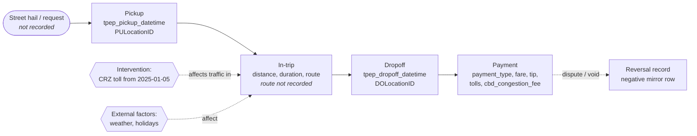
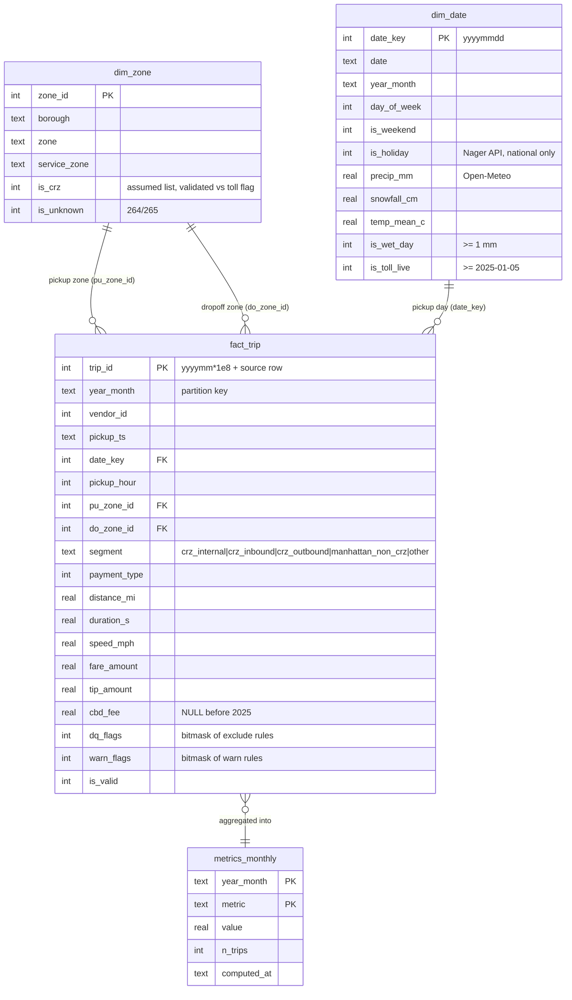

# Workflow & data model (Class 7)

## 1. The operational workflow of a taxi trip

| Element | In our model |
|---|---|
| **Entities** | Trip (fact_trip), Zone (dim_zone), Day (dim_date). Vendor and payment type are attributes on the trip |
| **Events / states** | pickup → dropoff → payment → (optional) reversal. A record's data-quality state is `is_valid` + `dq_flags` / `warn_flags` |
| **Interventions** | CRZ congestion toll (`dim_date.is_toll_live`, zone `is_crz`) |
| **External factors (confounders)** | Weather (`is_wet_day`, snowfall), holidays (`is_holiday`), weekend |
| **Outcomes** | In-trip speed, duration tail (p90), fare per engaged hour, trip volume |
| **Comparison group** | Trips wholly inside Manhattan north of the CRZ (`segment = manhattan_non_crz`) |

## 2. Relational (star) model - SQLite `warehouse/tlc.sqlite`

**Grain decisions**
- `fact_trip` keeps **one row per source record, including invalid ones**. Nothing is deleted, and every exclusion is visible as a flag and traceable to its source row through `trip_id`.
- `segment` is derived from the pickup and dropoff zones: `crz_internal` (both ends in the CRZ), `crz_inbound`, `crz_outbound`, `manhattan_non_crz` (the control group), and `other`.
- The KPI population is `segment = 'crz_internal'`, valid, non-holiday weekday, pickup 05:00–20:59 (the toll peak window).

## 3. Metrics linked to the KPI

| Metric | Formula (SQL) | Role |
|---|---|---|
| valid_trip_rate | `SUM(is_valid) / COUNT(*)` for the month | Trust gate |
| **crz_median_speed_mph** | median(`speed_mph`) over the KPI population | **Project KPI** |
| control_median_speed_mph | same, `segment = 'manhattan_non_crz'` | Counterfactual |
| crz_p90_duration_min | p90(`duration_s`)/60 over the KPI population | Reliability |
| crz_fare_per_engaged_hour | `SUM(fare_amount) / SUM(duration_s/3600)`, reversal twins excluded | Driver economics |
| crz_touching_trips_per_weekday | valid trips in the 3 CRZ segments / working weekdays | Demand |
| crz_median_speed_dry_days | KPI with `is_wet_day = 0` | Sensitivity (weather) |
| crz_median_speed_excl_pt0 | KPI excluding `payment_type 0` | Sensitivity (data-mix shift) |
