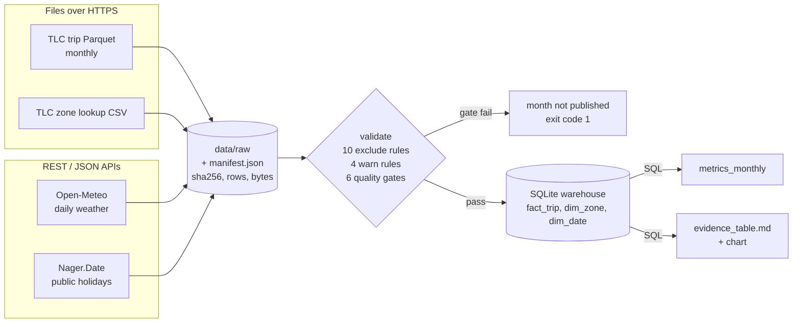

# Source map (Class 4)

## Business question → information needed → source

| # | Business question (leadership) | Information required | Source system | Field(s) used |
|---|---|---|---|---|
| Q1 | Did trips inside the Congestion Relief Zone (CRZ) get faster after the toll started? | Trip start/end time, distance, start/end zone | TLC Yellow Taxi trip records | `tpep_pickup_datetime`, `tpep_dropoff_datetime`, `trip_distance`, `PULocationID`, `DOLocationID` |
| Q2 | Which trips are "inside the CRZ"? | Zone → borough/name, and whether the zone is in the CRZ | TLC Taxi Zone Lookup + **our CRZ zone list** (assumption), cross-checked with `cbd_congestion_fee` | `LocationID`, `Borough`, `Zone`; `cbd_congestion_fee` (2025+) |
| Q3 | Would speeds have changed anyway (weather, calendar)? | Daily precipitation/snow/temperature; public holidays | Open-Meteo Historical Weather API; Nager.Date Public Holiday API | `precipitation_sum`, `snowfall_sum`, `temperature_2m_mean`; `date`, `global` |
| Q4 | Did drivers earn more per hour on the meter? | Metered fare, trip duration, reversal records | TLC trip records | `fare_amount`, durations; negative-fare mirror rows |
| Q5 | Did demand for zone trips fall? | Count of trips touching the CRZ per working day | TLC trip records + zone model + holiday calendar | derived `segment`, `dim_date.is_holiday` |
| Q6 | Can we trust this month's numbers? | Completeness and validity of each file | All sources + manifest | row counts, byte counts, rule flags |

## Source inventory

| Source | Owner | Retrieval mode | Grain | Refresh / latency | Raw copy kept | Completeness proof |
|---|---|---|---|---|---|---|
| Yellow Taxi Trip Records (`yellow_tripdata_YYYY-MM.parquet`) | NYC Taxi & Limousine Commission (TLC). Records are submitted by technology vendors (Creative Mobile = 1, Curb/VeriFone = 2, Myle = 6, Helix = 7) | **File over HTTPS** (Parquet) | One row per trip record (not strictly one per trip: reversals and adjustments appear as extra rows) | Monthly, published about 2 months after month end; past files are occasionally re-issued | `data/raw/*.parquet` + SHA-256 in `manifest.json` | HTTP `Content-Length` = bytes written; Parquet footer readable; rows read = footer row count; every calendar day present; min trips/day |
| Taxi Zone Lookup (`taxi_zone_lookup.csv`) | TLC | **File over HTTPS** (CSV) | One row per taxi zone (265) | Rarely changes | `data/raw/taxi_zone_lookup.csv` | ≥ 263 zones |
| Historical weather (Central Park point) | Open-Meteo (ERA5 reanalysis) | **REST API → JSON** | One row per day | Daily, ~5-day lag | `data/raw/weather_YYYY-MM.json` (verbatim response) | Exactly one record per calendar day |
| US public holidays | Nager.Date | **REST API → JSON** | One row per holiday (national + state) | Yearly | `data/raw/holidays_YYYY.json` | Non-empty list, ≥ 8 entries |
| Modelled warehouse | This project | **SQL** (SQLite): every metric is read out with SQL | fact = trip record; dims = zone, day | Rebuilt on each run, one partition per month | reproducible from raw | Loaded row count = validated row count (checked after insert) |

## Important gaps (what the sources cannot tell us)

| Gap | Why it matters | How we handle it |
|---|---|---|
| **No CRZ flag on zones**, and `cbd_congestion_fee` only exists from Jan 2025 | We can't label 2024 trips as CRZ from the toll field, so the before/after comparison needs a definition that works in both years | Zone-based CRZ list (assumption), validated against the 2025 toll flag in a quality gate |
| No GPS route | A trip between two non-CRZ zones may still pass through the CRZ | CRZ-internal trips (both ends inside) are the KPI population; "passes through" trips are out of scope |
| No request/dispatch time for street hails | Customer wait time can't be measured, only in-trip time | KPI is in-trip speed; wait time recorded as Unknown |
| No driver or medallion ID | We can't compute utilisation or idle time, only revenue per **engaged** hour | Stated as a limitation |
| Tips recorded only for card payments; `payment_type 0` rows lack passenger/rate fields | Tip-inclusive revenue would be biased by the payment-type mix | Revenue KPI uses metered `fare_amount` only |
| Trip records include accounting reversals (negative mirror rows) | Summing fares naively would double-count voided trips | Negative rows excluded; the positive twin is flagged and left out of revenue metrics |

## Source → model lineage

