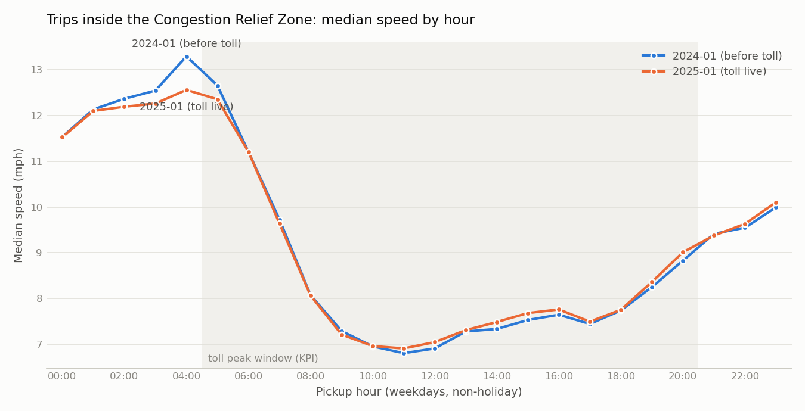

# Evidence table - CRZ congestion pricing vs taxi trip performance

_Generated 2026-09-27 18:17 UTC by pipeline run `20260927T232524` - do not edit by hand; rerun `python -m pipeline.run`._

**Baseline:** 2024-01-05 to 2024-01-31 (no toll) | **Treatment:** 2025-01-05 to 2025-01-31 (toll live from 2025-01-05)

| # | Metric | Baseline | Treatment | Change | Trips (base / treat) | Business question |
|---|---|---|---|---|---|---|
| 1 | **valid_trip_rate** | 95.51% | 92.57% | -2.95 pp | 2,964,624 / 3,475,226 | Can leadership trust this month's numbers? |
| 2 | **crz_median_speed_mph** | 7.74 mph | 7.85 mph | +1.4% | 546,159 / 667,597 | Did trips inside the zone get faster? |
| 3 | **control_median_speed_mph** | 8.65 mph | 8.45 mph | -2.3% | 337,111 / 400,359 | Would speeds have changed anyway? |
| 4 | **crz_p90_duration_min** | 20.8 min | 20.1 min | -3.6% | 546,159 / 667,597 | Did the slow tail (reliability) improve? |
| 5 | **crz_fare_per_engaged_hour** | $63.07/h | $63.86/h | +1.3% | 541,482 / 658,570 | Do drivers earn more per hour on the meter in the zone? |
| 6 | **crz_touching_trips_per_weekday** | 68,057 | 77,918 | +14.5% | 1,225,029 / 1,480,434 | Did demand for zone trips fall because of the toll? |
| 7 | **crz_median_speed_dry_days** | 7.83 mph | 7.83 mph | +0.1% | 299,795 / 608,132 | Is the KPI change just weather? |
| 8 | **control_median_speed_dry_days** | 8.75 mph | 8.46 mph | -3.3% | 186,295 / 361,163 | Net of weather, is there still a CRZ effect? |
| 9 | **crz_median_speed_excl_pt0** | 7.72 mph | 7.80 mph | +1.0% | 530,575 / 599,745 | Is the KPI change caused by the shift in payment_type 0 records? |

**Net KPI effect vs control (difference in % change): +3.7%** - the part of the CRZ speed change not explained by the change seen outside the zone.

**Net KPI effect vs control, dry days only: +3.4%** - the same comparison with rain/snow days removed from both groups and both years.

## Metric definitions

- **valid_trip_rate** - Share of all trip records passing every exclude rule
- **crz_median_speed_mph** - PROJECT KPI. Median speed (distance/duration) of CRZ-internal trips, weekday peak
- **control_median_speed_mph** - Same as KPI, for Manhattan trips wholly outside the CRZ (no toll)
- **crz_p90_duration_min** - 90th-percentile duration of CRZ-internal weekday-peak trips
- **crz_fare_per_engaged_hour** - Sum of metered fare / sum of trip hours, CRZ-internal weekday peak, reversals excluded
- **crz_touching_trips_per_weekday** - Valid trips starting and/or ending in the CRZ, per non-holiday weekday
- **crz_median_speed_dry_days** - Sensitivity: KPI restricted to days with < 1 mm precipitation
- **control_median_speed_dry_days** - Sensitivity: control-group median speed on days with < 1 mm precipitation
- **crz_median_speed_excl_pt0** - Sensitivity: KPI excluding payment_type 0 records

Population for metrics 2-5 and 7-9 (metric 5 also excludes reversed trips): valid trips, non-holiday weekdays, pickup 05:00-20:59. Metric 1 covers every record in the month.

## Context (from the weather + holiday APIs)

| Window | Working weekdays | Wet days (>=1 mm) | Snow days | Total precip (mm) | Mean temp (C) |
|---|---|---|---|---|---|
| 2024-01 | 18 | 12 | 8 | 155.8 | 1.1 |
| 2025-01 | 19 | 5 | 6 | 23.3 | -2.6 |

Hourly values: `crz_speed_by_hour.csv`. Validation detail: `validation/validation_<month>.md`.
